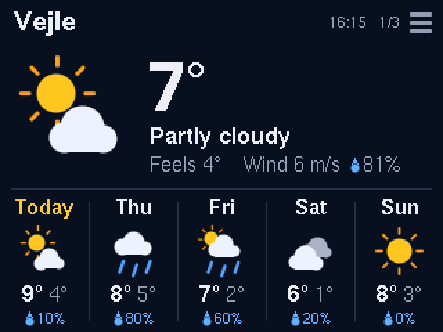
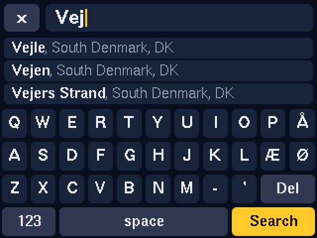
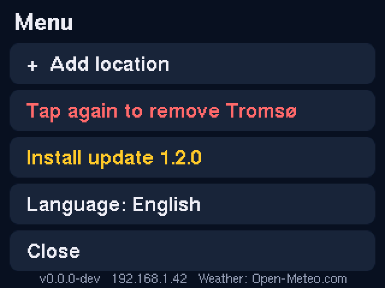
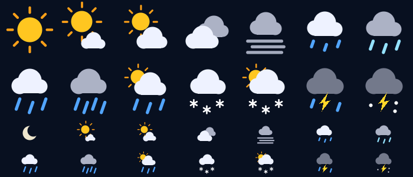

# CYD-weather-display

Weather display for the ESP32 **Cheap Yellow Display** (ESP32-2432S028R, 2.8" 320×240 touch screen).
It shows the current weather and a 5-day forecast for one or more locations. With several
locations, the pages rotate automatically.

## Install

👉 **Web installer: <https://martindamp.github.io/CYD-weather-display/>**

1. Open the installer in **Chrome** or **Edge** on a computer and plug in the CYD by USB.
2. Click **Install CYD Weather** and pick the serial port.
3. When the install is done, enter your **Wi-Fi** in the installer (Improv Wi-Fi).
4. On the screen, tap **+ Add location**, type a city, and tap a suggestion.

No credentials are built into the firmware. Wi-Fi and locations are stored on the device (NVS)
and survive restarts and OTA updates.

## Using it

| | |
|---|---|
|  |  |
| Type a place name and pick one of the live suggestions. Æ, Ø and Å are on the keyboard; `123` has digits (postcodes) and other accents. | Tap the header (☰) for the menu: add or remove a location, check for firmware updates, or change the language. |

- **Languages**: English, Danish, German and French. Change it under *Language* in the menu, or on the device web page. Weather descriptions, weekdays and place-name suggestions follow the language. Places you already added keep the name they were saved with.
- **Several locations**: pages rotate every 10 s (configurable). Tap the left or right half of the screen to flip manually.
- **Device web page**: open `http://<device-ip>/` (the IP is shown on the empty screen and in the menu). There you can add, reorder and remove locations from your phone, set the rotation speed, and update the firmware.
- **OTA updates**: *Check for updates* in the menu (or on the web page) compares with `version.txt` on GitHub Pages and installs the new firmware over Wi-Fi.
- **Change Wi-Fi**: reconnect to the web installer and choose *Connect to Wi-Fi*.

## Weather data

From [Open-Meteo](https://open-meteo.com/): free for non-commercial use, no API key needed.

- Forecast: `api.open-meteo.com/v1/forecast` (current temperature, feels-like, humidity, wind, WMO weather code, day/night, and daily max/min, weather code and precipitation probability). The timezone is set automatically for each location.
- Place search: `geocoding-api.open-meteo.com/v1/search`.
- Each location is refreshed every 15 minutes.

The icons are vector drawings (`src/weather_icons.h`), drawn anti-aliased on the device:

### Adding a language

All text is in `src/i18n.h` (device) and the `I18N` object in `src/web_page.h` (device web page). Add the language to `Lang`, `LANG_CODES` and `LANG_NAMES`, then add one column to each table. Only Latin-1 characters can be shown on the screen.

## Build it yourself

PlatformIO project: `pio run -e cyd` (the only environment). To flash over USB: `pio run -e cyd -t upload`.

A release is made by bumping `VERSION` and pushing to `main`. GitHub Actions (`.github/workflows/deploy.yml`) then builds the firmware, makes a merged factory image for the web installer, and publishes the installer plus the OTA files (`firmware/firmware.bin`, `version.txt`) to GitHub Pages.

> GitHub Pages must be set to **Source: GitHub Actions** (Settings → Pages).

### Screenshots without hardware

`tools/sim/render.sh` compiles the real drawing code in `src/main.cpp` against mock headers on a PC and writes the screens to `docs/*.png`. The screenshots in this README are made this way, so they are renderings, not photos of the panel.

## Troubleshooting

- **Colours wrong / screen black**: see the comments at the bottom of `platformio.ini` (inversion, RGB order, driver).
- **Taps land in the wrong place**: adjust `TOUCH_MINX/MAXX/MINY/MAXY`, or set `TOUCH_FLIP_X` / `TOUCH_FLIP_Y` at the top of `src/main.cpp`.
